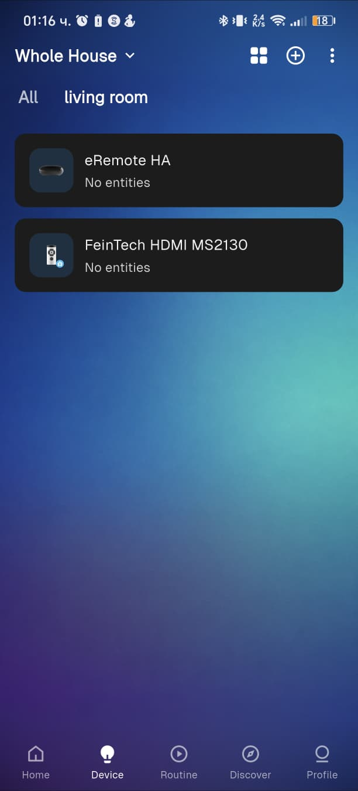
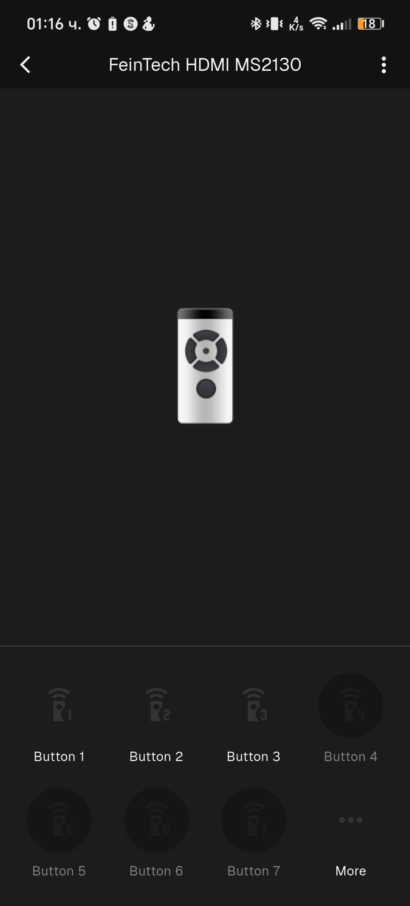

# IR HDMI input switching with LinknLink eRemote HA and Home Assistant

This draft shows a practical way to control an IR HDMI switch from Home Assistant through a LinknLink eRemote HA.

The switch is treated as a group of discrete input buttons. Home Assistant sends the learned IR command three times with a short delay and keeps a helper containing the last requested input. This makes the automation tolerant of an occasional missed IR transmission, but it does not create real feedback: IR is one-way.

## What this solves

- Select an HDMI switch input from a Home Assistant dashboard or automation.
- Use the same learned IR buttons for a capture path such as HyperHDR.
- Return a small response mapping to the caller so an automation can distinguish a successful command sequence from an unavailable button or invalid source.
- Make source selection explicit and repeatable when an automatic HDMI switch may select a different input while a source is still waking up.

## Hardware

- LinknLink eRemote HA IR hub.
- An IR-controlled HDMI switch with discrete input commands.
- Home Assistant with MQTT configured.
- Optional USB capture device and HyperHDR/Ambilight computer.

## Tested with

- FeinTech VSW03102 3x1 HDMI switch with automatic switching.
- LinknLink eRemote HA.
- Home Assistant 2026.10.x.
- MS2130 USB capture with HyperHDR.

## Setup

### 1. Add the eRemote HA

Power the eRemote HA and add it in the LinknLink app. The official guide says to use a 2.4 GHz Wi-Fi network, sign in, choose **Add for HA**, and follow the setup wizard. The eRemote and Home Assistant must be reachable on the same LAN during setup.

Official guide: <https://kb.linknlink.com/kb/smart-home-devices/eremote/set-up-eremote-ha>

LinknLink product information: <https://www.linknlink.com/products/eremote-ha-ir-remote-home-assistant-mqtt>

### 2. Configure MQTT

In the eRemote HA device page, open the MQTT connection settings, enter the broker details, and verify that the status is **Connected**. The learned IR device and its available controls should then appear in Home Assistant.

The official documentation describes this MQTT connection flow and automatic HA discovery. It does not document the exact fan workaround described below.

### 3. Add the HDMI switch as a fan

In the app, add the HDMI switch as a **fan** device when that device type exposes the required free learning buttons. Learn one discrete input command per button:

- Button 1 → switch input 1
- Button 2 → switch input 2
- Button 3 → switch input 3

The physical remote must have separate buttons for each input. A remote that only provides a single “next input” or cyclic input button is not suitable for this discrete-button pattern.

The exact device category workaround is an observed practical technique, not a LinknLink-documented feature. It may depend on the app version and available device templates.

Device list showing the eRemote and the learned HDMI-switch device:



Buttons 1–3 learned, one per HDMI input; unused buttons stay greyed out.



### 4. Verify the Home Assistant entities

After MQTT discovery, the learned controls should appear as separate button entities. This draft uses generic names:

```text
button.hdmi_switch_input_1
button.hdmi_switch_input_2
button.hdmi_switch_input_3
```

Replace these examples with the entities created by your own discovery. Do not assume that entity IDs or button numbering are universal.

### 5. Add the helper

The helper stores the last requested input. It is memory, not confirmation that the switch actually changed input.

See `examples/input_text_helper.yaml`.

### 6. Use the reliable script

See `examples/script_hdmi_switch_select.yaml`. The script:

1. validates the requested source;
2. checks that the corresponding button is available;
3. presses the same learned button three times;
4. waits 700 ms between presses;
5. updates the helper only after the sequence completes;
6. returns `success`, `source`, `commands_sent`, and a helper state.

The caller can inspect the response using Home Assistant's `response_variable` support. See `examples/automation_example.yaml`.

Home Assistant MQTT button documentation: <https://www.home-assistant.io/integrations/button.mqtt/>

Home Assistant scripts and returned responses: <https://www.home-assistant.io/docs/scripts/>

### 7. Example capture workflow

One possible arrangement is:

```text
source A ─┐
          ├─ HDMI switch ─ USB capture ─ HyperHDR
source B ─┘
```

An automation selects the capture input before enabling or using the capture pipeline. If the selected source was asleep, repeat the selection after approximately 10 seconds, after checking that the transition is still valid. This is useful for automatic switches that may fall back to another input when the requested source has not produced a signal yet.

## Lessons learned

- An automatic HDMI switch can move back to another input while the requested source is waking up.
- A delayed second selection can be more reliable than one immediate IR transmission.
- See `examples/automation_example.yaml` for the bounded delayed repeat-selection pattern.
- Three identical commands with a short interval improve command delivery but do not prove the physical switch state.
- The helper records the last requested input; it is not a feedback sensor.
- A source-selection script should return a mapping so the parent automation can decide whether to continue, notify, or retry.
- Keep the retry bounded and guard it with the current transition state and source power state.

## Known limitations / TBD

- The eRemote HA setup requires an account in the app according to the official setup flow.
- Whether an already configured device continues to work with no Internet connection has not been verified: **TBD**.
- IR has no acknowledgement path in this design.
- A helper can become stale if someone changes the HDMI switch with its physical remote.
- The fan-category workaround is not confirmed as an official LinknLink feature.
- Entity names, button numbering, IR range, and automatic-switch behavior vary by hardware and firmware.

## License

MIT. See `LICENSE`.
